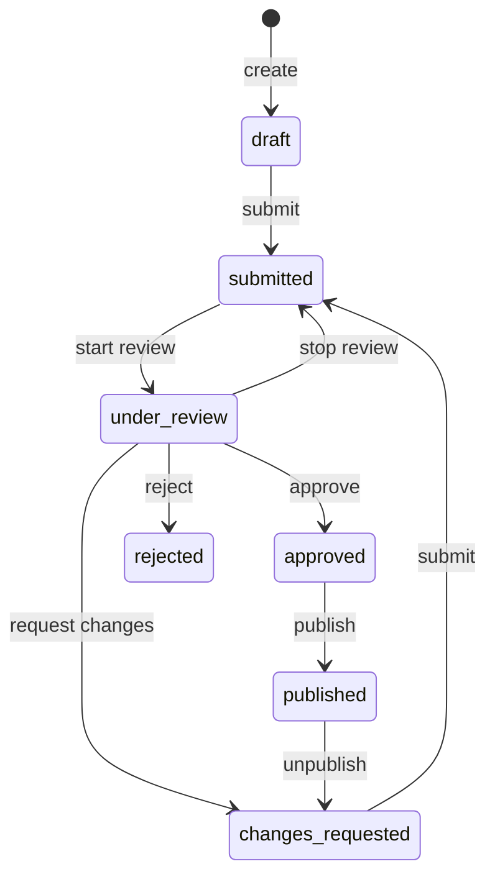

# Editorial workflow

Stories move from a journalist's draft through editorial review to the public feed. Every account has one role, journalist, editor or admin, which decides the pages it can open. The endpoints behind each step are in the [API reference](api.md).

## Roles

| Role | Works on |
|---|---|
| Journalist | Writing, editing and submitting their own stories; deleting their own drafts and archived stories |
| Editor | Reviewing submitted stories, publishing approved ones, unpublishing or deleting published ones, and reading analytics |
| Admin | Everything an editor does, plus managing accounts and creating submission deadlines through the API |

## Story statuses

A journalist submits a draft. An editor starts a review and then approves the story, requests changes or rejects it; stopping a review returns the story to `submitted`. Approved stories are published to the feed, and unpublishing a story sends it back to the journalist as `changes_requested`. Journalists can edit and resubmit only drafts and stories with changes requested.

The API also accepts a review decision on a `submitted` story, which moves it to `under_review` first, and on an `approved` one. Journalists can publish their own approved stories through the API; the web app shows the publish button only to editors and admins. The API's `archive/` action moves a story in any status to `archived`; the web app has no archive button.

## Pages

| Route | Who can open it | What it does |
|---|---|---|
| `/feed` | Everyone | Lists published stories with search, a category filter and a date range that starts at 2026-06-01 by default |
| `/feed/:slug` | Everyone | Shows one published story |
| `/login` | Everyone | Signs you in or creates an account |
| `/stories` | Signed-in users | Lists stories by status tab with upcoming deadlines, and deletes drafts and archived stories; journalists see only their own |
| `/stories/new`, `/stories/:id/edit` | Signed-in users | Edits a story's title, summary, body, category, tags and breaking-news flag, and submits it for review |
| `/review` | Editors, admins | Lists stories by status tab with the next actions: start or stop a review; approve, request changes or reject; publish; unpublish or delete a published story |
| `/analytics` | Editors, admins | Shows each journalist's stories published this month, filters by name, category or tag, and downloads PDF reports |
| `/admin` | Admins | Adds, edits, activates, deactivates and deletes accounts |
| `/profile` | Signed-in users | Changes your name, email address or password |

`/` and unknown paths redirect to `/feed`. After sign-in, journalists land on `/stories`, and editors and admins on `/review`. The story editor saves the story every 60 seconds while it has unsaved changes, a title and a category.

## Notifications

### Unread badges

The `/stories` and `/review` pages show how many unread stories each status tab holds, and a story counts as unread again when its status changes. Read state is kept in the browser's local storage, so it belongs to the browser rather than the account.

### Emails

The backend sends these emails to journalists:

| Email | Sent when |
|---|---|
| Story submitted | Their story's status becomes `submitted`, and again whenever it is saved while `submitted` |
| Story approved | Their story is approved |
| Changes requested | Changes are requested on their story, or it is unpublished; includes the reviewer's comment |
| Story rejected | Their story is rejected; includes the reviewer's comment |
| Deadline reminder | A deadline is about an hour away and they have a draft or changes-requested story in its category |

The development settings use Django's console email backend. Each email is printed to the terminal of the process that sends it, `runserver` for story emails and `process_tasks` for reminders, and nothing is delivered.

Deadline reminders come from a background task that `python manage.py seed_data` queues. While `python manage.py process_tasks` runs, the task checks every five minutes for deadlines 60 to 65 minutes away. Without `process_tasks`, no reminders are sent.

## Categories, broadcast slots and deadlines

The web app has no screens for creating categories, broadcast slots or deadlines; `seed_data` creates a starting set. Admins can create deadlines with `POST /api/v1/news/deadlines/`. To manage all three, open the Django admin at `http://127.0.0.1:8000/admin/` with a staff account. The demo accounts are not staff, so create one with `python manage.py createsuperuser`.

## Story formatting

When a story is saved, the backend keeps these HTML tags and removes all others, leaving their text in place: `p`, `b`, `i`, `em`, `strong`, `ul`, `ol`, `li`, `h2`, `h3`, `blockquote`, and `a` with its `href` and `title` attributes.
